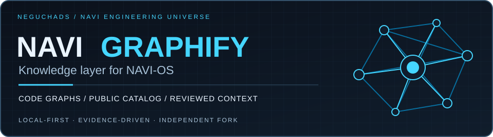
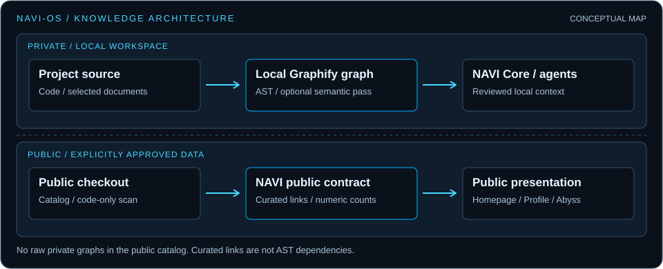

<p align="center"><a href="https://github.com/Neguchads/navi-graphify"></a></p>

<p align="center">
  <a href="https://github.com/Neguchads/navi-graphify/actions/workflows/ci.yml"></a>
  <a href="https://github.com/Neguchads/navi-graphify/actions/workflows/public-portfolio.yml"></a>
  <a href="LICENSE"></a>
  <a href="https://github.com/Neguchads/navi-core"></a>
  <a href="https://github.com/Neguchads/navi-graphify"></a>
</p>

<p align="center"><strong>Knowledge graphs for engineering, agents and projects.</strong><br />
Local context · Versioned public catalog · Evidence-driven engineering</p>

<p align="center"><a href="README.md">English</a> · <a href="README.pt-BR.md">Português brasileiro</a> · <a href="https://github.com/Neguchads/Neguchads">NAVI-OS</a> · <a href="https://github.com/Neguchads/navi-graphify/issues">Issues</a> · <a href="https://github.com/Neguchads/navi-graphify/releases">Releases</a></p>

# NAVI Graphify

**NAVI Graphify is the knowledge layer of NAVI-OS**, maintained within the Neguchads engineering ecosystem. It integrates the open-source Graphify engine with a versioned public project catalog, structural summary exports and a local-first context workflow.

This is an independent integrated fork in development preview. The graph engine keeps its existing package and CLI identity for compatibility; the NAVI integration is not an official Graphify Labs product.

[Quickstart](#quickstart) · [Capabilities](#capabilities) · [NAVI ecosystem](#navi-ecosystem) · [Public portfolio](#public-portfolio) · [Privacy](#privacy) · [Documentation](#documentation)

---

## See how it connects

<p align="center"></p>

*Conceptual architecture, not a runtime screenshot, live health indicator or extracted dependency graph.*

The local graph helps humans and coding agents navigate a project. The public contract describes selected repositories and explicitly curated relationships. These are separate data paths; private graph artifacts are not inputs to the public exporter.

## Capabilities

| Capability | Responsibility |
|---|---|
| Local structural extraction | Tree-sitter AST for supported languages; no model needed for code-only extraction. |
| Graph navigation | Query concepts, explain nodes and trace paths; distinguish extracted and inferred edges. |
| Optional semantic extraction | Documents and media may require a configured model/backend; review its data handling. |
| Agent integration | Existing Graphify skills, CLI and optional local MCP; NAVI Core supplies separate portable engineering context. |
| Public catalog | Versioned, curated project membership and explicit integration relationships. |
| Structural summaries | Allowlisted numeric graph counts from approved public checkouts, tied to a commit. |
| Public presentation | NAVI GitHomepage renders catalog data; the Neguchads profile orchestrates public snapshots; Abyss is optional. |

## Quickstart

Requirements: Git and Python 3.11.5–3.14. Use an isolated environment. Install from this fork, not the upstream PyPI release, to get the NAVI integration.

```sh
git clone https://github.com/Neguchads/navi-graphify.git
cd navi-graphify
python -m venv .venv
# Activate .venv for your shell.
python -m pip install .
graphify --help
```

For PowerShell, activation is `.\.venv\Scripts\Activate.ps1`; on POSIX shells use `source .venv/bin/activate`.

Run in a project you are authorized to inspect:

```sh
graphify extract . --code-only
graphify query "How do the main components connect?"
graphify explain "ComponentName"
graphify path "ComponentA" "ComponentB"
```

Replace example names with actual nodes. The standard graph workflow uses `graphify-out/graph.json`, `GRAPH_REPORT.md` and `graph.html`; available artifacts depend on the extraction/export command. Review generated files before sharing.

### Coding agents

After inspecting the install instructions, optionally install project-scoped guidance:

```sh
graphify install --project --platform codex
# Alternative: graphify install --project
```

Use the agent's Graphify skill (for Codex, `$graphify`; for Claude Code, `/graphify`). These are alternatives, not required simultaneous installations. Local MCP is optional; install `.[mcp]` from this checkout and consult `graphify-mcp --help`. Neither the NAVI catalog nor code-only extraction requires a cloud account.

## NAVI ecosystem

| Module | Role |
|---|---|
| [NAVI Core](https://github.com/Neguchads/navi-core) | Engineering contracts, verification and reviewed local context. |
| [NEF](https://github.com/Neguchads/navi-core/blob/main/docs/NEF.md) | Reference profiles, roadmap, handoff and reviewed learning. |
| [Universal Agent Interface](https://github.com/Neguchads/navi-core/blob/main/docs/UNIVERSAL_AGENT_INTERFACE.md) | Provider-independent context and structured handoff. |
| [NAVI Graphify](https://github.com/Neguchads/navi-graphify) | Local graph tooling and public catalog contract. |
| [NAVI GitHomepage](https://github.com/Neguchads/navi-githomepage) | Visual cards and interactive explorer renderer. |
| [NAVI Abyss](https://github.com/Neguchads/navi-abyss) | Optional immersive presentation. |
| [Neguchads Profile](https://github.com/Neguchads/Neguchads) | Public command center and project discovery. |

[Engineering Universe](https://github.com/Neguchads/Neguchads/blob/main/docs/UNIVERSE.md) · [Adaptive Knowledge Engine](https://github.com/Neguchads/navi-core/blob/main/docs/ADAPTIVE_KNOWLEDGE.md) · [Roadmap](https://github.com/Neguchads/navi-core/blob/main/docs/ROADMAP.md)

## Public portfolio

The [catalog](integrations/portfolio/catalog.json) is the source of versioned sector membership and curated integration edges. For a numeric structural summary:

```sh
python integrations/portfolio/export_public.py chad-recomp --out public-summary.json
```

The exporter restricts input to catalog repositories, checks public visibility, clones a fresh checkout and runs code-only extraction with the semantic backend disabled. It reconstructs numeric node, edge, community and confidence counts plus the public slug and commit; it does not export raw graph content. Review the resulting JSON before publication. Missing summaries are unavailable, not zero.

[Portfolio bridge](integrations/portfolio/README.md) · [Universe data contract](integrations/portfolio/UNIVERSE.md) · [NAVI pilot](docs/NAVI_PILOT.md)

## Privacy

- Keep private graphs, source paths, prompts, credentials and agent sessions out of public artifacts.
- Code-only extraction is local; optional semantic backends can transmit selected content depending on configuration.
- The public exporter does not accept arbitrary local graph files. Public visibility is checked at export time; publication still requires review.
- Curated catalog membership does not establish code dependencies, security compliance or production readiness.

## Validation and contribution

From the installed environment:

```sh
python -m unittest discover -s integrations/portfolio -p "test_*.py"
```

The original engine CI remains authoritative for engine changes. The NAVI pilot adds a complementary gate. See the [CI runs](https://github.com/Neguchads/navi-graphify/actions), [contribution guide](CONTRIBUTING.md) and [security policy](SECURITY.md). Report fork-specific issues in [this repository](https://github.com/Neguchads/navi-graphify/issues). NAVI-specific performance claims require their own reproducible evidence.

## Documentation

**[NAVI documentation hub](docs/navi/README.md)** · [Roadmap](docs/ROADMAP.md) · [Handoff](docs/HANDOFF.md) · [Decisions](docs/navi/DECISIONS.md) · [Operations](docs/navi/OPERATIONS.md)

| Guide | Scope |
|---|---|
| [Architecture](ARCHITECTURE.md) / [How it works](docs/how-it-works.md) | Inherited graph engine architecture. |
| [Portfolio bridge](integrations/portfolio/README.md) / [Universe contract](integrations/portfolio/UNIVERSE.md) | NAVI public data model and exporter. |
| [NAVI pilot](docs/NAVI_PILOT.md) | Verification and rollout boundaries. |
| [Benchmarks](BENCHMARKS.md) | Inherited upstream experiments; not independent NAVI results. |
| [Docker/MCP integration](docs/docker-mcp-sqlite.md) | Optional engine integration. |
| [Changelog](CHANGELOG.md) | Engine history. |

<details><summary>Upstream technical reference and translations</summary>

The inherited engine reference (including original installation options, platform matrix, configuration, full command reference and legacy translations) is preserved in the [pre-rebrand README](https://github.com/Neguchads/navi-graphify/blob/7225f0ebad7d0e8f6a8e47d004158a64588b41ee/README.md) and [upstream documentation](https://docs.graphify.com). These describe upstream Graphify; its commercial services, package downloads and benchmarks are not NAVI services or metrics. The current NAVI introduction is available in English and Brazilian Portuguese.

</details>

## License and attribution

NAVI Graphify is an independent, community-maintained fork of [Graphify](https://github.com/Graphify-Labs/graphify), not affiliated with or endorsed by Graphify Labs. Graphify and its original logo are upstream marks. Original authorship and copyright notices are retained; see [Apache-2.0](LICENSE), [historical MIT terms](LICENSE-MIT) and [NOTICE](NOTICE). NAVI branding identifies the integration, not ownership of the inherited engine.

---

<p align="center"><strong>Explore. Build. Verify.</strong><br /><a href="https://github.com/Neguchads">Neguchads</a> · <a href="https://github.com/Neguchads/Neguchads">NAVI-OS</a> · <a href="https://github.com/Neguchads/navi-core">NAVI Core</a></p>

[Open-source credits, provenance and distribution review](CREDITS.md).
