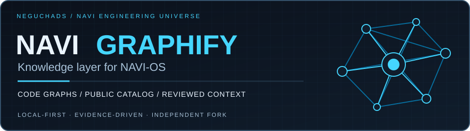
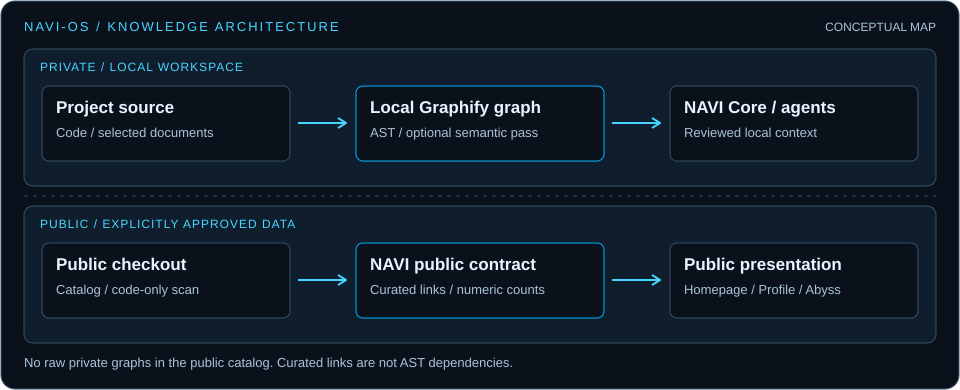

<p align="center"><a href="https://github.com/Neguchads/navi-graphify"></a></p>

<p align="center">
  <a href="https://github.com/Neguchads/navi-graphify/actions/workflows/ci.yml"></a>
  <a href="https://github.com/Neguchads/navi-graphify/actions/workflows/public-portfolio.yml"></a>
  <a href="LICENSE"></a>
  <a href="https://github.com/Neguchads/navi-core"></a>
  <a href="https://github.com/Neguchads/navi-graphify"></a>
</p>

<p align="center"><strong>Grafos de conhecimento para engenharia, agentes e projetos.</strong><br />
Contexto local · Catálogo público versionado · Engenharia orientada a evidências</p>

<p align="center"><a href="README.md">English</a> · <a href="README.pt-BR.md">Português brasileiro</a> · <a href="https://github.com/Neguchads/Neguchads">NAVI-OS</a> · <a href="https://github.com/Neguchads/navi-graphify/issues">Problemas</a> · <a href="https://github.com/Neguchads/navi-graphify/releases">Releases</a></p>

# NAVI Graphify

**NAVI Graphify é a camada de conhecimento do NAVI-OS**, mantida no ecossistema de engenharia Neguchads. Integra o motor open source Graphify a um catálogo público versionado, exportações estruturais e fluxos de contexto local-first.

É um fork independente em desenvolvimento. O pacote e o CLI do motor preservam seus nomes por compatibilidade; a integração NAVI não é um produto oficial da Graphify Labs.

[Início rápido](#início-rápido) · [Capacidades](#capacidades) · [Ecossistema NAVI](#ecossistema-navi) · [Portfólio público](#portfólio-público) · [Privacidade](#privacidade) · [Documentação](#documentação)

---

## Como tudo se conecta

<p align="center"></p>

*Mapa conceitual, não captura de execução, indicador de saúde ou grafo de dependências extraído.*

O grafo local auxilia humanos e agentes a navegar pelo projeto. O contrato público descreve repositórios selecionados e relações explicitamente curadas. São fluxos separados; grafos privados não são entradas do exportador público.

## Capacidades

| Capacidade | Responsabilidade |
|---|---|
| Extração estrutural local | AST via tree-sitter para linguagens suportadas, sem modelo no modo somente código. |
| Navegação de grafos | Consultas, explicação de nós e caminhos; distinção entre relações extraídas e inferidas. |
| Extração semântica opcional | Documentos e mídia podem exigir modelo/backend configurado; revise o tratamento dos dados. |
| Integração com agentes | Skills, CLI e MCP local opcionais do Graphify; contexto de engenharia separado pelo NAVI Core. |
| Catálogo público | Participação em setores e relações de integração curadas e versionadas. |
| Resumos estruturais | Contagens numéricas permitidas de checkouts públicos aprovados, vinculadas a commits. |
| Apresentação pública | NAVI GitHomepage renderiza o catálogo; o perfil Neguchads orquestra snapshots públicos; Abyss é opcional. |

## Início rápido

Requisitos: Git e Python 3.11.5–3.14. Instale este fork em ambiente isolado, não o pacote upstream do PyPI, para acessar a integração NAVI.

```sh
git clone https://github.com/Neguchads/navi-graphify.git
cd navi-graphify
python -m venv .venv
# Ative .venv no seu terminal.
python -m pip install .
graphify --help
```

No PowerShell: `.\.venv\Scripts\Activate.ps1`; em shells POSIX: `source .venv/bin/activate`.

Execute em um projeto que você esteja autorizado a inspecionar:

```sh
graphify extract . --code-only
graphify query "Como os componentes principais se conectam?"
graphify explain "ComponentName"
graphify path "ComponentA" "ComponentB"
```

Substitua os nomes de exemplo pelos nós reais. O fluxo padrão utiliza `graphify-out/graph.json`, `GRAPH_REPORT.md` e `graph.html`; os artefatos disponíveis dependem do comando de extração/exportação. Revise antes de compartilhar.

### Agentes de programação

Opcionalmente, após revisar as instruções, instale a configuração no projeto:

```sh
graphify install --project --platform codex
# Alternativa: graphify install --project
```

Use a skill correspondente (`$graphify` no Codex ou `/graphify` no Claude Code). São alternativas, não instalações simultâneas obrigatórias. Para MCP local opcional, instale `.[mcp]` a partir deste checkout e consulte `graphify-mcp --help`. O catálogo NAVI e a extração somente código não exigem conta em nuvem.

## Ecossistema NAVI

| Módulo | Função |
|---|---|
| [NAVI Core](https://github.com/Neguchads/navi-core) | Contratos, verificação e contexto local revisado. |
| [NEF](https://github.com/Neguchads/navi-core/blob/main/docs/NEF.md) | Perfis de referência, roadmap, handoff e aprendizado revisado. |
| [Universal Agent Interface](https://github.com/Neguchads/navi-core/blob/main/docs/UNIVERSAL_AGENT_INTERFACE.md) | Contexto independente de fornecedor e handoff estruturado. |
| [NAVI Graphify](https://github.com/Neguchads/navi-graphify) | Ferramentas de grafos locais e contrato público. |
| [NAVI GitHomepage](https://github.com/Neguchads/navi-githomepage) | Cards e renderização do explorador interativo. |
| [NAVI Abyss](https://github.com/Neguchads/navi-abyss) | Apresentação imersiva opcional. |
| [Neguchads Profile](https://github.com/Neguchads/Neguchads) | Central pública e descoberta de projetos. |

[Engineering Universe](https://github.com/Neguchads/Neguchads/blob/main/docs/UNIVERSE.md) · [Adaptive Knowledge Engine](https://github.com/Neguchads/navi-core/blob/main/docs/ADAPTIVE_KNOWLEDGE.md) · [Roadmap](https://github.com/Neguchads/navi-core/blob/main/docs/ROADMAP.md)

## Portfólio público

O [catálogo](integrations/portfolio/catalog.json) registra setores e relações de integração curadas. Para obter um resumo estrutural numérico:

```sh
python integrations/portfolio/export_public.py chad-recomp --out public-summary.json
```

O exportador restringe a entrada a repositórios do catálogo, verifica a visibilidade pública, clona um checkout novo e executa extração somente código com backend semântico desativado. Reconstrói contagens de nós, arestas, comunidades e confiança, além do slug público e commit; não exporta o conteúdo bruto do grafo. Revise o JSON antes da publicação. Resumos ausentes são indisponíveis, não zero.

[Bridge do portfólio](integrations/portfolio/README.md) · [Contrato Universe](integrations/portfolio/UNIVERSE.md) · [Piloto NAVI](docs/NAVI_PILOT.md)

## Privacidade

- Não publique grafos privados, caminhos de fontes, prompts, credenciais ou sessões de agentes.
- A extração somente código é local; backends semânticos opcionais podem transmitir conteúdo selecionado conforme a configuração.
- O exportador público não aceita grafos locais arbitrários. A visibilidade pública é checada durante a exportação; a publicação exige revisão.
- As relações curadas não representam dependências de código, conformidade de segurança ou certificação de produção.

## Validação e contribuição

```sh
python -m unittest discover -s integrations/portfolio -p "test_*.py"
```

O CI original permanece como referência para alterações no motor. O piloto NAVI adiciona uma verificação complementar. Consulte [CI](https://github.com/Neguchads/navi-graphify/actions), [contribuição](CONTRIBUTING.md) e [segurança](SECURITY.md). Reporte problemas do fork nas [issues deste repositório](https://github.com/Neguchads/navi-graphify/issues). Métricas de desempenho NAVI exigem evidências reproduzíveis próprias.

## Documentação

| Guia | Escopo |
|---|---|
| [Arquitetura](ARCHITECTURE.md) / [Funcionamento](docs/how-it-works.md) | Motor de grafos herdado. |
| [Bridge](integrations/portfolio/README.md) / [Universe](integrations/portfolio/UNIVERSE.md) | Contrato e exportador público NAVI. |
| [Piloto NAVI](docs/NAVI_PILOT.md) | Limites de verificação e adoção. |
| [Benchmarks](BENCHMARKS.md) | Experimentos upstream, não resultados independentes NAVI. |
| [Docker/MCP](docs/docker-mcp-sqlite.md) | Integração opcional do motor. |
| [Changelog](CHANGELOG.md) | Histórico do motor. |

<details><summary>Referência técnica e traduções upstream</summary>

A [documentação anterior à reformulação](https://github.com/Neguchads/navi-graphify/blob/7225f0ebad7d0e8f6a8e47d004158a64588b41ee/README.md) preserva instalação, plataformas, configuração, comandos completos e traduções herdadas. A [documentação upstream](https://docs.graphify.com) descreve o motor original; serviços comerciais, downloads e métricas upstream não são serviços ou métricas NAVI. A apresentação NAVI atual está disponível em inglês e português brasileiro.

</details>

## Licença e atribuição

NAVI Graphify é um fork independente de [Graphify](https://github.com/Graphify-Labs/graphify), sem afiliação ou endosso da Graphify Labs. O nome e o logotipo original Graphify são marcas upstream. Autoria e avisos originais são preservados: [Apache-2.0](LICENSE), [termos MIT históricos](LICENSE-MIT) e [NOTICE](NOTICE). A identidade NAVI representa a integração, não a autoria do motor herdado.

---

<p align="center"><strong>Explore. Build. Verify.</strong><br /><a href="https://github.com/Neguchads">Neguchads</a> · <a href="https://github.com/Neguchads/Neguchads">NAVI-OS</a> · <a href="https://github.com/Neguchads/navi-core">NAVI Core</a></p>
