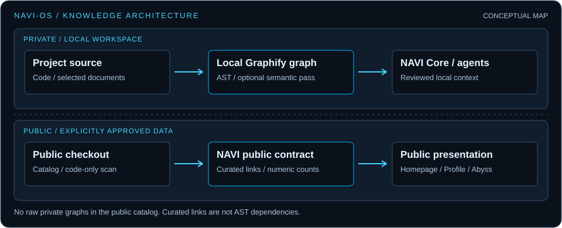

# NAVI Graphify architecture

NAVI Graphify is an independent integration of the upstream Python engine with NAVI's public catalog and local knowledge workflows. The repository is not a cloud service or a replacement for NAVI Core.

## Layers and ownership

| Layer | Source of truth | Responsibility |
|---|---|---|
| Graph engine | `graphify/`, [engine architecture](../../ARCHITECTURE.md) | AST extraction, optional semantics, graph queries, clustering and exports |
| Assistant adapters | `tools/skillgen/` and generated skills | Existing host-specific graph guidance |
| Public contract | [catalog.json](../../integrations/portfolio/catalog.json) | Editorial membership and explicit integration edges |
| Public bridge | [export_public.py](../../integrations/portfolio/export_public.py) | Numeric allowlisted structural summaries from fresh public checkouts |
| Universe snapshot | [universe_snapshot.py](../../integrations/portfolio/universe_snapshot.py) | Public GitHub metadata, bounded history, provenance |
| Core / NEF | [NAVI Core](https://github.com/Neguchads/navi-core) | Engineering contracts, reviewed context, handoff and complementary verification |
| Presentation | [NAVI GitHomepage](https://github.com/Neguchads/navi-githomepage), [profile](https://github.com/Neguchads/Neguchads), [Abyss](https://github.com/Neguchads/navi-abyss) | Rendering and optional immersive experience |

## Local workflow

1. Inspect a trusted workspace and exclude sensitive material.
2. Extract AST-only code using Graphify; semantic extraction is a separate opt-in choice.
3. Query the local graph with the CLI or a configured MCP client.
4. Optionally review a bounded node-link snapshot for ingestion into Core's Adaptive Knowledge Engine. Core does not invoke Graphify automatically. Its explicit digest approval, project scope and revocation rules remain authoritative.
5. Verify important graph-derived conclusions against source and tests. An inferred edge is not proof.

## Public workflow

1. Select a repository explicitly allowed by the versioned catalog.
2. Check its public status; the exporter clones anonymously with isolated Git configuration and no recursive submodules.
3. Run code-only extraction with the semantic backend disabled.
4. Reconstruct only numeric counts, the public slug, commit and confidence counts. Raw graph files remain temporary.
5. The snapshot producer combines approved public summaries with public GitHub metadata. Profile publication is a separate orchestration responsibility.

The bridge's optional metadata token is not passed to the source clone/extraction. The manifest's public-export prohibition applies to private knowledge, not an authorization to publish any arbitrary graph. Never repurpose the bridge for private source. A public visibility check is point-in-time, and output still requires review.

Catalog relationships are curated; code edges are extracted or inferred. Missing structural summaries are unavailable, not zero. The public snapshot records source commits; incompatible schema changes require coordinated consumer updates.

## Invariants

- Preserve upstream graph provenance and deterministic structural extraction.
- Keep local raw graphs, cache, credentials, prompts and agent sessions outside public outputs.
- Keep package `graphifyy` and CLI `graphify` compatible until an independently reviewed distribution migration.
- Keep engine CI authoritative and NAVI gates complementary.
- Do not claim live service health or runtime integration from a conceptual diagram.
- Do not modify generated skills by hand.

See [operations](OPERATIONS.md), [decisions](DECISIONS.md) and [roadmap](../ROADMAP.md).
